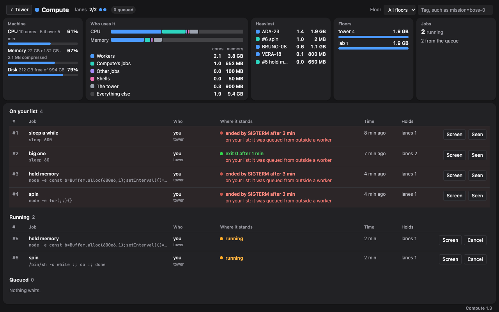
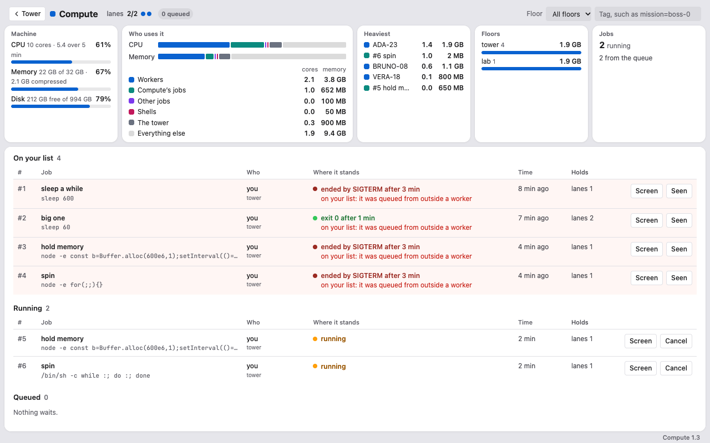
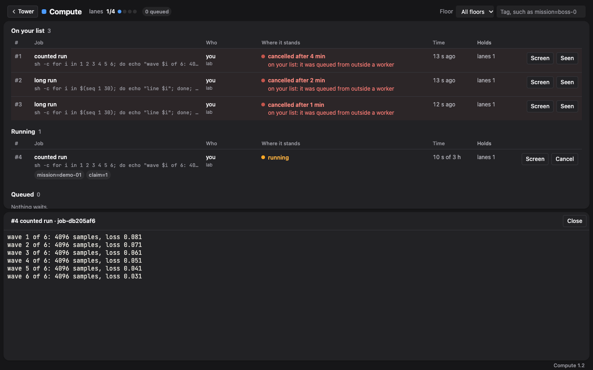

# Compute

A queue for long or heavy commands on the machine [the tower](https://github.com/RegiByte/the-tower) runs on. Many
workers on many floors share one machine: compute starts each command in the tower's jobs daemon only once the
machine's named resources (lanes, a GPU…) have room for it, oldest first, and tells whoever queued it, at their
prompt, when it is over.

It is an extension of the tower: the tower's
[guide to extending it](https://github.com/RegiByte/the-tower/blob/main/docs/extending.md) explains the terms below
(verbs, reads, streams, the board, the jobs daemon). Why it exists and where it goes next:
[docs/design.md](docs/design.md).

## What it adds

### The `tower` command

Workers read its guidance in `tower x compute`, and its brief in `tower whoami`.

```text
$ tower x compute run --need lanes=2 --hours 3 --label "counted run" -- ./run_waves.sh
Queued #7 counted run, 1 ahead of it. It starts once the machine has room (`tower x compute jobs`), and you are told
at your prompt when it is over.

$ tower x compute jobs
lanes 3 of 4 in use · 1 queued
#6 running 41 min (job-15d672a7) · smoke · lanes 1 · BRUNO-08 on research · mission=boss-05-mwckzpdm
#7 running 12 min (job-7f6be1c7) · counted run · lanes 2 · BRUNO-08 on research
#8 queued, waits for 2 lanes (1 of 4 free) · rebuild · lanes 2 · VERA-18 on research
#5 over: exit 0 after 2 h 10 min · regen · lanes 1 · BRUNO-08 on research
```

- `run [--need <resource>=<units>]… [--hours <h>] [--tag <name>=<value>]… [--cap <tag>=<n>]… [--label <words>]
  [--cwd <dir>] [--cleanup <command>] -- <command…>` queues a command.
  - `--need`: what it holds while it runs, in units of the machine's resources. Left out, the settings'
    `defaultNeeds` (one lane).
  - `--hours`: how long you expect it to run. The queue says when it runs past it; a caller such as the lab can act
    on that.
  - `--tag name=value`: words to group your jobs by. Compute gives them no meaning; reads filter on them.
  - `--cap tag=n`: at most `n` jobs carrying this job's value of `tag` run at once, whatever room the machine has.
    The lab caps each mission this way.
  - `--cwd`: the folder it runs in, absolute or relative to your checkout; your checkout when left out.
  - `--cleanup`: a shell command run in that folder once the job is over, cancelled included, with `COMPUTE_JOB` set
    to the job's number. It is for what the job starts outside its own process group, which the jobs daemon doesn't
    stop with it: containers labelled with `$COMPUTE_JOB`, say.
  - It is refused up front when it could never start: a resource the machine doesn't name, more units than the machine
    has, a cap on a tag the job doesn't carry.
- `jobs [--tag <name>=<value>] [--all true]`: the machine's resources in use, and each job queued, running, or over
  within the last day, with where it stands and, for a queued one, what it waits for.
- `cancel <n>`: a queued job is withdrawn; a running one is cancelled in the jobs daemon (SIGTERM to its process group,
  SIGKILL 5 s later), then its cleanup runs and its requester is told.
- `seen <n>`: takes a job off your list (below).
- `machine`: the machine and who uses it, read when asked: the load against the cores, memory in use, the disk holding
  your home folder, and every process's CPU and memory by owner, the heaviest workers and jobs by name. See
  [Who uses the machine](#who-uses-the-machine).

When a job is over, its cleanup runs, then its requester is told, in this order:

1. **Running:** one line at its prompt, queued while it works.
2. **Running but busy** with a question to you or a Claude screen, which refuses typed text: tried again every few
   seconds until it takes the line.
3. **Not running**, stopped, killed, lost, sent home or let go: **resumed** in its latest conversation, with the line as
   its first prompt and a word on why it is back. A worker that was let go is found in its floor's archive.
4. **Not found at all**, or its resume refused (its worktree can't be restored, say), or a job queued from outside any
   worker: the job goes on **your list** on the tower page, at its floor, with a **Seen** button.

The line:

```text
[compute] Your job #7 (counted run) is over: exit 0 after 2 h 10 min. Its screen: `tower job list` names it
(job-7f6be1c7), and the tower serves it at /job/job-7f6be1c7/screen while it keeps it.
```

### The Compute page

A renderer at `/r/compute/`, drawn from the board (compute's own part, `x.compute`, and the tower's) and compute's
`machine` read. It wears the look of
[Lobby](https://github.com/fliptaboada/tower-renderer-lobby), the tower's macOS-style page: the jobs in a card set into
the window, the system face, greys and a blue accent, light or dark as the tower's scheme is. Colour is kept for where a
job stands: a job past its hours or on your list in red, a running one amber, one that exited 0 green, a queued or
withdrawn one grey.

- **The top:** a **Tower** button back to the tower page, then each resource's units in use out of the machine's, as a row of lamps that turns red when it is full and
  jobs wait, and how many are queued. A floor picker and a tag filter, kept in the page's hash so a link keeps them.
- **The machine,** a band of tiles over the jobs, so the queue is seen beside everything else that shares it, read
  every 10 s while the page is in sight: the **Machine**'s CPU, memory and disk as gauges that turn amber, then red;
  **Who uses it**, CPU and memory each a bar split by owner (workers, compute's jobs, other jobs, the tower's shells,
  the tower itself, everything else); the **Heaviest** workers and jobs; the **Floors** by their workers' memory, with
  how many are on duty; and every **Job** the jobs daemon runs, compute's or not, by who started it. Under 720 px the
  tiles scroll sideways.
- **The jobs,** in sections: on your list, running, queued, and over in the last day. Each row: its number, label,
  command and tags (a tag filters the page by it), who queued it and from which floor, where it stands (what a queued
  job waits for, a running one past its hours, how an over one ended and how its requester was told), how long it has
  waited or run or how long ago it ended, and what it holds. Under 720 px wide, each job's cells stack.
- **Its buttons:** **Screen** opens the job's live screen in a card under the jobs, read only, as the jobs daemon keeps it;
  **Cancel** (**Withdraw** while queued) and **Seen** call compute's own verbs, so a worker can do the same from the
  `tower` command.
- **Its foot:** the version of Compute the tower loaded (see [Which version you run](#which-version-you-run)).

| Dark | Light |
| --- | --- |
|  |  |



### For other extensions

`compute/run`, `compute/cancel` and the read `compute/jobs` are its API. An extension that uses it declares it as
wanted, so it still loads where compute is off:

```json
{ "wants": { "compute": "1.0" } }
```

Then `ctx.deps.compute` is defined while compute runs, and a handler calls `call.call('compute/run', {...})` with its
caller's call, so compute knows who asked and tells them. Tags group the caller's jobs (`mission=<id>`), and caps hold
a group to a number of running jobs. [The lab](https://github.com/agencyenterprise/tower-extension-lab) is built this
way. `contract.json` lists the names held at major 1: they only grow within it.

## Add it

It needs the tower 2.10 or later (a job's `pid` on the board) and Node 24, and nothing else: it has no runtime
dependencies.

```sh
git clone git@github.com:agencyenterprise/tower-extension-compute.git
```

Then name its folder in the tower's config (`~/.tower/config.json`), with the machine's resources. An extension can't
declare a renderer, so the config names the page's folder too:

```json
{
  "extensions": {
    "compute": {
      "path": "/Users/you/code/tower-extension-compute",
      "settings": { "resources": { "lanes": 6, "gpu": 1 }, "defaultNeeds": { "lanes": 1 } }
    }
  },
  "renderers": { "compute": { "root": "/Users/you/code/tower-extension-compute/renderer" } }
}
```

A floor's shelf can frame the page beside its sessions: `{ "label": "Compute", "renderer": "compute" }`.

`tower config check` checks the edit, and `tower extensions` lists it once the tower has read it.

| Setting | Default | What it is |
| --- | --- | --- |
| `resources` | `{ "lanes": 4 }` | What the machine has room for, in units of named resources. A job starts only while the units it needs are free. Machine-wide: a floor's own value is not read. Lowering it never stops a running job. |
| `defaultNeeds` | `{ "lanes": 1 }` | What a job that says nothing of its needs holds while it runs. |

## Which version you run

The Compute page's foot shows it: **Compute 1.4**, as the tower loaded it, with its state when it isn't running. Its
tip names the tower's version too; press it to copy that line, for a bug report. `tower extensions` says the same.

The version is `extension.json`'s `version`, `major.minor` as the tower reads it. A major breaks what other
extensions want of Compute (a name in `contract.json` removed, renamed or changed in meaning); every other release is
a minor. Releases are tagged `v<version>`, and [CHANGELOG.md](CHANGELOG.md) says what each one changed (each tag's
message carries its section too). [The release skill](.claude/skills/release/SKILL.md) holds the steps: the checks,
the changelog, the bump, the tag, and moving a tower onto it.

To update: `git pull` in your clone, then `tower extensions restart compute`, and reload the page.

## How it works

- **Facts, not state.** `run` appends a `j` fact to compute's `queue` stream (system-wide, so every floor's jobs share
  one machine). The scheduler appends `o` when it starts a job in the jobs daemon (naming the daemon's job id), `f`
  when the daemon refuses it, `q` when a queued job is withdrawn, and `y` once a job is over and its requester was
  told. Jobs are numbered from 1 in the order they were queued. Where a started job stands, running, ended, cancelled
  or lost, is never stored: it is read from the board's `jobs`, which the jobs daemon's log holds.
- **The scheduler** runs every 5 s, and once at each `run`. It first tells the requesters of jobs that are over, after
  their cleanup, then starts the oldest queued jobs that fit: a job whose needs or cap don't fit is passed by younger
  ones that do. While the jobs daemon doesn't answer it does nothing, so a lost job is never taken for over while the
  daemon is down.
- **Telling** types one line at the requester's prompt (`tower/submit`, queued while it works); a prompt busy with a
  question or a screen (`not_at_prompt`) is tried again next round. A requester that isn't running is resumed through
  the `resume` its card offers (on the board, else in `tower/archive/<project>`), with the line as its first prompt. The
  `y` fact records whom it told and the session it resumed, or why it couldn't (`failed`): the board part then puts the
  job on the user's list at its floor until `seen` (an `s` fact).
- **The board part** (`board.x.compute`) holds the resources, the units in use, the queue's length and the jobs worth
  showing, each as the `jobs` read gives it: a page draws from it with no read of its own.
- **Jobs outlive the tower, not the jobs daemon.** A job runs in the jobs daemon, outside the tower: it outlives a
  restart of the tower or of compute, which picks up where its facts left off. Stopping the jobs daemon ends every
  job, so a long run should be able to resume.
- **Nothing secret goes in.** A job's command and label are kept in the jobs log every worker and renderer reads, and
  its env holds only `COMPUTE_JOB` and `GIT_TERMINAL_PROMPT=0`. A command that needs a key reads it from its own
  folder.
- **The pure part** (`compute.ts`) holds what the facts mean, which jobs start, and the words. `server.ts` is the shell
  around it: the stream, the board, the jobs daemon, the prompts.

### Who uses the machine

The `machine` read is computed when asked and never stored; a read within 5 s of the last answers the last, so pages
open together run `ps` once.

- **Load, memory, disk.** The load averages against the cores. Memory in use as Activity Monitor counts it, from
  `vm_stat` on macOS (wired, compressed, and programs' own pages less the purgeable ones), and from `/proc/meminfo` on
  Linux (the total less what is available); Node's own free memory leaves out what caches hold and reads near zero on
  a busy Mac. The disk is the one holding your home folder.
- **By owner.** Two `ps` reads give every process's parent, process group, CPU and resident memory, and its
  environment. A process is a compute job's when it carries `COMPUTE_JOB` or is in the group of a running job compute
  started (a job's pid is its process group); another job's when it is in another running job's group; a worker's when
  it carries `TOWER_SESSION_ID`, which every process a worker starts inherits, whatever its runtime; the tower's when it
  is one of its daemons; a shell's when the terms daemon started it. Otherwise it is its parent's, so a program that
  hides its environment (Apple's own binaries do) counts as whoever started it, and what is left is everything else.
- **What the numbers are.** CPU is ps's percent of one core, an average over the last moments, shown in cores.
  Memory is resident memory, which counts shared pages in each process and leaves out what the compressor holds, so the
  owners' sum is not the memory in use.

Not yet here, in the order [docs/design.md](docs/design.md) gives: spend pools for paid API keys, floors on memory and
disk that hold starts back, holds and bumps, and a place in the tower page itself.

## Working on it

```sh
npm install
npm run types       # tower types .: the library's declarations for this tower, in .tower/ (git-ignored)
npm run typecheck   # the server, and the page's JavaScript through JSDoc
npm test            # node --test over compute.ts
npm run check       # tower extensions check .
```

Try a change on a tower checkout's sandbox (`npm run sandbox -- up` there), never on your real tower first: name this
folder in the sandbox's config, then `npm run -s sandbox -- run tower x compute jobs`. After a change to the manifest's
names, `tower extensions freeze .` rewrites `contract.json`: adding a name is a minor, removing or renaming one a major.
Each change adds its line under `## [Unreleased]` in [CHANGELOG.md](CHANGELOG.md); releasing is
[the release skill](.claude/skills/release/SKILL.md)'s.
